<div align="center">


# AutoStock AI

**Inventory and demand forecasting for auto parts shops.**
Know what you have, what is selling, and what to order.


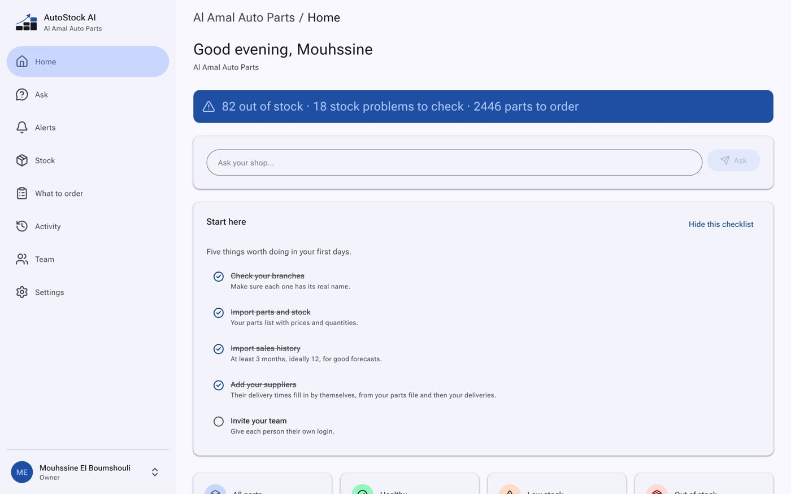

</div>

## Why

Most small auto parts shops in Morocco run their stock on Excel. They run out of the parts that sell and
keep money stuck in parts that never move. AutoStock AI answers three questions every day:

1. **What do I have?** Stock per branch, in plain words: *In stock*, *Low stock*, *Out of stock*.
2. **What is selling?** Sales forecasts for the next 7, 30 and 60 days, with an honest range.
3. **What should I order?** Quantities per supplier, each with a one-line reason. A person approves every line.

It starts from the Excel files a shop already has, runs on one shop PC, and is free.

This project grew out of a summer internship (July–August 2026, remote) with **Bounaim Auto**, a car parts
import and export company in Béni Mellal, as part of the engineering programme at
**EIDIA – Université Euromed de Fès**.

## What it does

| | |
|---|---|
| 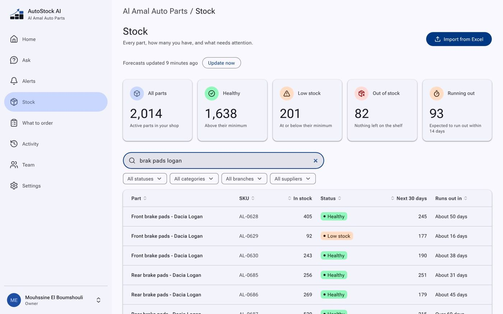<br>**Search that forgives typos** — "brak pads logan" finds Dacia Logan brake pads; part numbers in any format; synonyms in French, English, Arabic and Darija. | 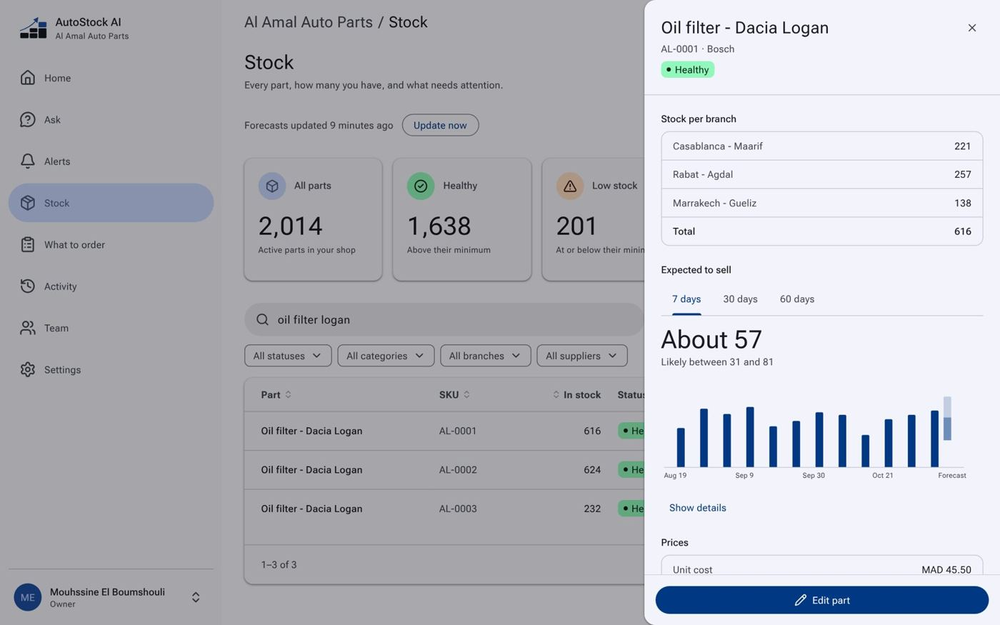<br>**One page per part** — stock per branch, forecast with its range, price, and equivalent parts from other brands. |
| 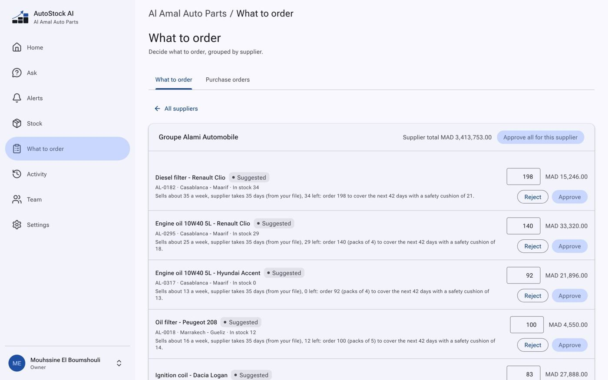<br>**What to order** — grouped by supplier, rounded to pack sizes, optional budget. Every line says why. Approve, edit or refuse; then print the purchase order. | 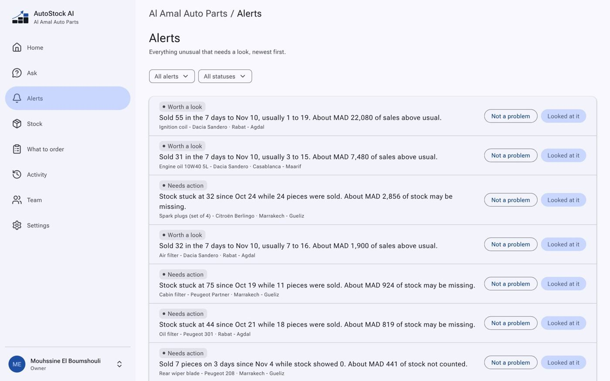<br>**Daily alerts** — stock that does not match sales (negative stock, sold at zero, frozen stock) and unusual sales spikes or drops, at most 3 a day. |
| 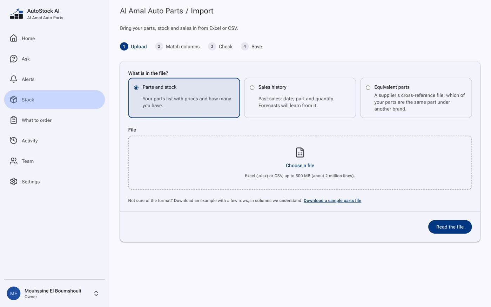<br>**Import the shop's own files** — Excel or CSV, columns matched automatically, every refused line explained, up to about 2 million sales lines. | 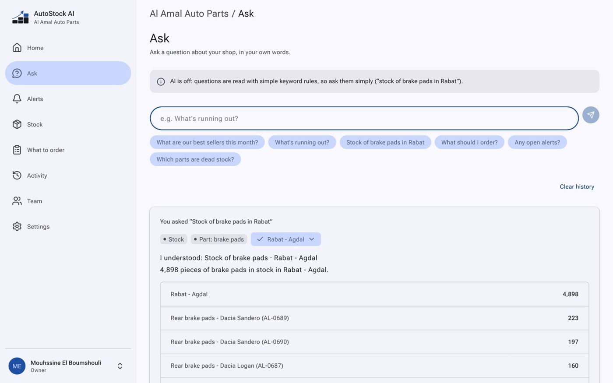<br>**Ask your shop** — questions in plain words, answered from the shop's real numbers. Every number is checked, and the data used is shown under the answer. |

Also: French, English and Arabic (right to left) · works on desktop, tablet and phone · roles (owner, manager, staff — staff never see money) · every change logged · nightly checked backups · full Excel export.

## Results

Measured on a realistic **simulated** shop (2,014 parts, 3 branches, 2 years and 838,738 sales lines) where the
true future demand is known. These numbers show the method works on that shop; a trial in a real shop is the next step.

| Question | Result |
|---|---|
| Better forecasts than a 4-week average? | **37% less error at 60 days** (95% CI 35–40%), 27% at 30 days (24–29%), 8% at 7 days (6–10%) (WAPE vs true demand, paired bootstrap) |
| Fewer lost sales for the same money in stock? | **5.5% of sales lost**, vs 8.1% for the classic reorder point and 16.4% for the "minimum stock" rule (182-day replay) |
| Stock problems caught? | 24 of 24 planted problems, 0 false alerts |
| Assistant answers right? | 42 of 50 right, 6 partly right, 1 wrong, 1 blocked by the number check |
| Search finds the right part? | 88% first result, 98% in the top 3 (40 new searches) |
| Fast on a big shop (50,000 parts, 20.9M sales lines)? | Stock and search pages 0.02–0.4 s; What to order 0.14 s |

<p align="center">
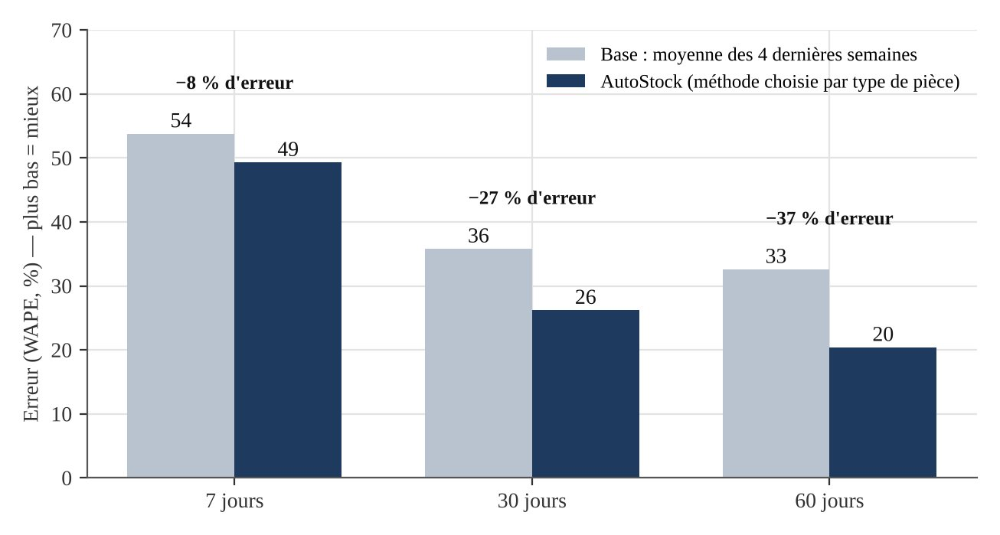 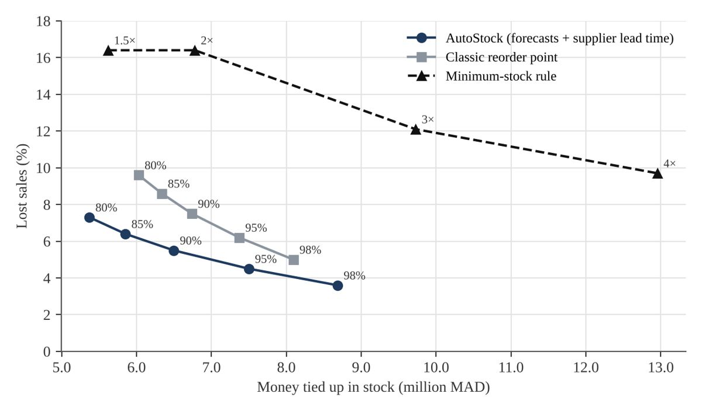
</p>

Everything can be measured again with three commands (see [Demo shop and forecasts](#demo-shop-and-forecasts)).

## How it works

<p align="center">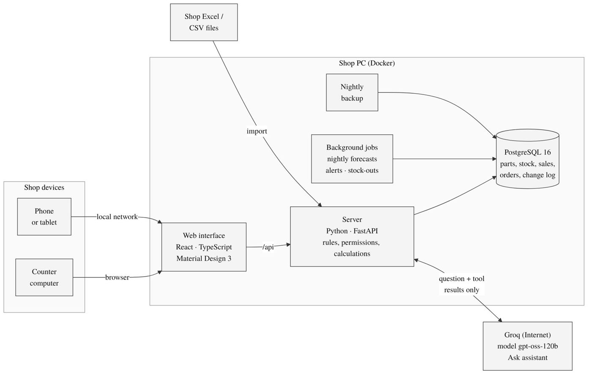</p>

- **Forecasts.** Each part is classed by how it sells (smooth, erratic, slow, lumpy). For each class, several methods
  compete on 12 past windows: 4-week average (the baseline), exponential smoothing, Croston, SBA, TSB and a global
  gradient-boosting model (scikit-learn). A method is used only if it beats the baseline by at least 5%.
  Stock-out days count as unknown demand, never as zero sales. Ranges are tuned to hold the real sale about 8 times in 10.
- **Orders.** Plain maths, not a language model: cover the supplier's delivery time plus one week, add a safety margin
  from the forecast range (90% service target), subtract stock and open orders, round to the pack size.
  With a budget, keep the lines that avoid the most lost profit per dirham.
- **Alerts.** Fixed rules for stock problems; a Poisson / negative-binomial test for unusual sales, with thresholds
  tuned on a separate simulated shop.
- **Ask.** An online model (Groq, free tier) calls the app's read-only tools, scoped to the shop and the person's role.
  It never sees the database. Every number in its answer must come from a tool result, or the answer is not shown.

The full method, with formulas and confidence intervals, is in the [internship report](docs/internship-report.pdf).

## The story: from Odoo to a lean app

<p align="center">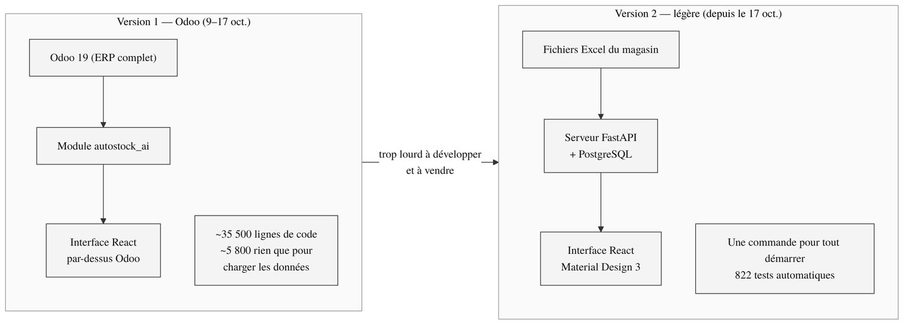</p>

**Version 1 (9–17 October 2026)** was an add-on for **Odoo 19**, the open-source business system:
forecasts at 7/30/60 days (random forest vs baselines and Croston), stock-risk warnings, read-only reorder
suggestions, and a React site on top. After 9 days we stopped:

- **Heavy to build** — most of the work went into the platform. About 25 pull requests were only about loading demo
  data into Odoo or fixing the Windows setup; about 5,800 lines of code just loaded test data.
- **Heavy to adopt** — a shop would need a whole business system to use the app, while most small parts shops use Excel.
- **Too complicated** — Odoo's rules pulled the screens away from a design a normal employee can use.
- **Key features missing** — purchase orders, budgets, the assistant, PDF output, French and Arabic.

**Version 2 (17 October – 10 November 2026)** is this repository: FastAPI + PostgreSQL + React, no ERP, fed
directly by the shop's Excel files. It is faster to install (one command), simpler to use, easier to change,
and covers far more: import, search, orders and budgets, alerts, the assistant, three languages, backups and export.

The Odoo version is kept untouched on the
[`archive/odoo-v0`](https://github.com/MouhssineElBoumshouli/autostock-ai/tree/archive/odoo-v0) branch
([screenshot](https://github.com/MouhssineElBoumshouli/autostock-ai/blob/archive/odoo-v0/docs/qa/screenshots/issue-34-gate-7-employee-first/forecasts-by-part-30-day-1440.png)).
The full story, step by step: [docs/journey.md](docs/journey.md).

## Built with

| Part | Tools |
|---|---|
| Website | React, TypeScript, Vite, Tailwind CSS, shadcn/ui, TanStack Query, Recharts — Material Design 3 style |
| Server | Python 3.12, FastAPI, SQLAlchemy 2, Alembic, Pydantic |
| Database | PostgreSQL 16 (with `pg_trgm` for typo-tolerant search) |
| Forecasting | NumPy, scikit-learn |
| Assistant | Groq (`openai/gpt-oss-120b`, free tier), optional local model through Ollama |
| Running | Docker Compose — one command, nightly backups |
| Quality | 826 automated tests (pytest) |

## Project documents

- [Internship report (PDF)](docs/internship-report.pdf)
- [Install guide for a shop (French, then English)](docs/INSTALL.md)
- [Project journey](docs/journey.md) · [Plan](PLAN.md)

## Authors

- **Mouhssine El Boumshouli** — architecture, back-end, website and design
- **Badr Lasri** — internship and company relationship, mathematical methods and statistical evaluation

Engineering students at EIDIA, Université Euromed de Fès. Internship supervisor: M. Habib Ouayloul (Bounaim Auto).
Built with the help of an AI coding assistant (Claude Code).

---

# Developer guide

## Install it in a shop

**[docs/INSTALL.md](docs/INSTALL.md)** (French, then English): one PC in the shop, the other computers
and phones open it on the shop network. In short:

```
docker compose -f docker-compose.prod.yml up -d --build
```

Production mode (`docker-compose.prod.yml`): one container serves the built website and `/api` on
port 8080, with no reload, no `/api/docs`, no `/design`; a strong database password is required;
every service restarts by itself; a daily checked backup goes to the `backups` folder; an update
backs up first. The commands in this README (`docker compose up`) are for developing only.

## Run it on Windows (developing)

1. Install and open **Docker Desktop**. Wait until it says "Engine running".
2. Open a terminal (PowerShell or Command Prompt) in this folder.
3. Optional: copy the settings file and change the database password.
   ```
   copy .env.example .env
   ```
   Do this before the first start. The database keeps the password it was created with.
4. Start everything:
   ```
   docker compose up
   ```
   The first start downloads and builds images. It takes a few minutes. Later starts take seconds.
5. Open **http://localhost:5173**. The first time, you see **Set up your shop**: enter the shop name,
   your name, email and a password (10+ characters). You become the owner and are logged in.
   Setup only works once. After that, everyone logs in at http://localhost:5173/login.

Stop with `Ctrl+C`, or `docker compose down` from another terminal.
Your data stays in a Docker volume. `docker compose down -v` deletes it.

## What runs

| Service | What it is | Address |
|---------|------------|---------|
| `web` | The website (React + Vite) | http://localhost:5173 |
| `api` | The server (FastAPI) | reached through the website at `/api`, e.g. http://localhost:5173/api/health |
| `db`  | The database (PostgreSQL 16) | inside Docker only |

Server API docs: http://localhost:5173/api/docs

Design system (every button, card, table… in one page): http://localhost:5173/design
It only exists while developing. New screens are built from these pieces.
Colors, sizes and corners are defined once, in `frontend/src/index.css`.

Code changes reload by themselves: save a file in `frontend/` or `backend/` and the page or server updates.
If you change `package.json`, `requirements.txt` or a `Dockerfile`, run `docker compose up --build`.

## Accounts

- Roles: **owner** (manages the team), **manager**, **staff**. Owners add people on the **Team** page with a temporary password.
- Someone with a temporary password (new, or reset by an owner) must choose their own right after logging in.
- Anyone can change their password from the menu under their name (bottom of the sidebar). This logs them out on their other devices.
- 5 wrong passwords for one email within 15 minutes block that email for 15 minutes.
- A login lasts until 7 days without use. Every change to people or settings is written to the `audit_log` table.

## Pages

| Page | Who sees it | What it shows |
|------|-------------|---------------|
| Home | everyone | greeting, stock numbers and low stock (once there are parts), last 5 events (owners and managers) |
| Stock | everyone (owners and managers can edit) | all parts with search, filters, sorting and a detail panel per part |
| Import | owners, managers | bring parts, stock and sales in from Excel (.xlsx) or CSV, in 4 steps |
| Activity | owners, managers | the shop's history in plain sentences, 25 per page, filter by person and type |
| Team | owners | add people, change roles, reset passwords, deactivate |
| Settings | owners | shop name, currency (MAD, EUR or USD), language, backups (installed version), branches, suppliers, search words, orders |

## Tests

With the app running, in another terminal:

```
docker compose exec api pytest
```

This skips the one `slow` test, which builds and forecasts the full ~2,000-part demo shop (a few
minutes on its own). Run it with:

```
docker compose exec api pytest -m slow
```

Tests use their own database (`autostock_test`), so they never touch your data.
Example import files (a messy French one and a clean English one per kind) are in `backend/tests/fixtures/`.
They are only for tests; `python tests/fixtures/make_fixtures.py` (inside the api container) rebuilds them.

## Demo shop and forecasts

A made-up demo shop (about 2,000 parts, 3 branches, 24 months of sales) to try forecasts on.
It is its own organization, marked as demo; running it again replaces it and never touches a real shop.

```
docker compose exec api python -m app.demo.demo_shop
docker compose exec api python -m app.demo.check_forecasts
docker compose exec api python -m app.demo.check_confidence
```

The first command prints a login for the demo shop (a new password each time).
The second command remakes the demo shop's forecasts and scores them against the true demand the demo was made from.
The third gives 95% confidence intervals for those scores (paired bootstrap over part-branch pairs, 2,000 resamples, about 2 minutes).
Forecasts are remade by themselves after every sales import, or with `POST /api/forecasts/run` (owners and managers).

To try the app like a new shop, this writes the same data as the files a real shop would have, into `trial/` (git-ignored, nothing is added to the database). `Pièces.xlsx` carries each supplier's delivery time; importing it into a shop that already has these parts only fills in the delivery times:

```
docker compose exec api python -m app.demo.trial_files
```

A shop tried with these files stops on the day they were made. To bring it up to yesterday the way a real shop does
with its daily file, this writes only `Ventes récentes.csv` / `.xlsx` (the same sales, from the day given to
yesterday), to import on the Import page:

```
docker compose exec api python -m app.demo.trial_files --recent-from=2026-11-04
```

### Big test shop (speed checks only)

A second made-up shop, never shown in the presentation: 50,000 parts, 3 branches, 2 years of sales
with the same mix as the demo (about 21 million sales lines). It replaces only itself, never the demo
or a real shop. Making it takes about 15 minutes; then time every page (20 tries each):

```
docker compose exec api python -m app.demo.big_shop
docker compose run --rm -e CHECK_PASSWORD=<printed password> api python -m app.demo.check_speed --url http://api:8000 --email big@autostock.local
```

Add `--actions` to also time the order buttons (adds suggestions and a purchase order to that shop),
or `--while-forecasting` to start a forecast run and time a few pages while it works.

## Ask your shop (optional local AI)

The app always writes the answers itself, in the question's language (English, French, or Arabic,
also for Darija questions), from the shop's real numbers. Without AI, questions are read by simple
keyword rules ("stock of brake pads in Rabat"); nothing extra is needed, and the Ask page says so at
the top. With the free local AI (Ollama, model `qwen3:4b-instruct`, about 2.5 GB downloaded once,
nothing leaves the computer), the model reads questions asked in any words and follow-ups
("and in Rabat?", "et le mois dernier ?"). Each person's last 20 questions are kept and shown again.

On a computer with an NVIDIA graphics card (much faster), start it with:

```
docker compose --profile ai-gpu up
```

Without one: `docker compose --profile ai up` (works, but answers take much longer).

**Close heavy apps (games, animated wallpapers, many browser tabs) before using it on a 4 GB
graphics card.** Windows and open apps already use part of the card's memory; if the model doesn't
fit, part of it runs on the processor and answers get several times slower. Check with
`docker compose exec ollama-gpu ollama ps`: the PROCESSOR column should say mostly GPU. If it says
100% CPU even with apps closed, restart the AI once: `docker compose --profile ai-gpu restart ollama-gpu`.

To score the reading on the 60 open test questions (good answers, refusals, seconds):

```
docker compose exec api python -m app.ask.check_assistant qwen3:4b-instruct --misses
```

### The online assistant (Groq, free) — the best answers

With a free Groq key, Ask becomes a real assistant: Groq's `openai/gpt-oss-120b` understands any
question, looks things up with the app's read-only tools (stock, sales over any period, stock-outs,
forecasts, orders, alerts, suppliers, prices) and answers in the question's language. Every number in
its answer is checked against what the tools returned; the lookups are shown under "Based on".
**What is sent to Groq:** the question, the conversation and the tool results — never the database,
never passwords (Groq does not train on them). Staff never get money. Without internet, or once the
free daily limit is reached, one line says so and the app answers itself as above. Results and
limits: `docs/ask-real-assistant.md`.

1. Make a free account at https://console.groq.com and create an API key ("API Keys").
2. Put it in `.env`: `GROQ_API_KEY=gsk_...` (never in git), then `docker compose up -d` again.
3. It is on by default; the owner can turn it off in **Settings → Online assistant**, which also shows
   how many answers are left today.

To score it on the 50 questions about the owner's trial shop (needs a copy of that shop):
`docker compose exec api python -m app.ask.check_real_assistant` (add `--owner` for his 10 questions).

## Database changes

Database changes (migrations) live in `backend/migrations/versions/` and run automatically when the server starts.
To create a new one after changing tables:

```
docker compose exec api alembic revision --autogenerate -m "describe the change"
```

## If something goes wrong

- **Port 5173 is already in use**: set another port in `.env`, e.g. `WEB_PORT=5174` and `APP_URL=http://localhost:5174`, then open that port.
- **"This request did not come from the AutoStock website"**: `APP_URL` in `.env` must be exactly the address in your browser bar.
- **Start over with an empty shop**: `docker compose down -v`, then `docker compose up` (this deletes all data).
- **Badge says "Can't reach server"**: run `docker compose logs api` to see the server's error.
