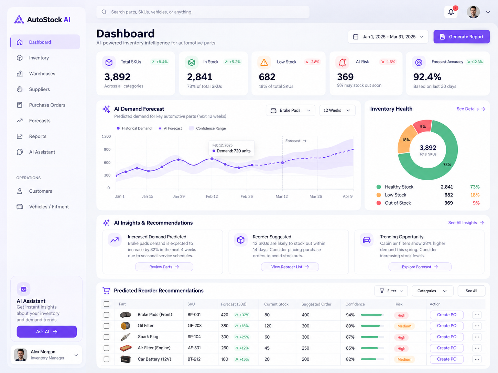

# How AutoStock AI got here

AutoStock AI was built twice. This page tells the story, so it can be shown in a presentation.

## Version 1 — built on Odoo (9–17 October 2026)

**The idea:** Odoo is a big open-source business system (stock, sales, purchasing, accounting).
Building AutoStock AI as an Odoo add-on meant getting stock and purchasing for free, and adding the AI on top.

**What it had:**
- Odoo 19 + PostgreSQL in Docker, with a custom `autostock_ai` module
- Demand forecasts for 7, 30 and 60 days (random forest compared against simple baselines and Croston's method for slow-moving parts)
- Stock-risk warnings and read-only reorder suggestions
- A React website on top of Odoo with Dashboard, Inventory, Warehouses, Suppliers and Forecasts screens
- A realistic Moroccan demo shop: 150 parts, 2 warehouses, 90 forecasts

**What we learned:**

| | Odoo version |
|---|---|
| Time | 9 days |
| GitHub issues and pull requests | 63 |
| Lines of code | about 35,500 |
| Lines just to load demo data into Odoo | about 5,800 |
| Documentation files | 131 |

- **Odoo was heavy to work with.** Most of the effort went into fighting the platform, not building the product. About 25 pull requests were only about loading demo data into Odoo safely and fixing Windows setup problems.
- **Odoo is heavy to sell.** A shop would have to adopt a whole business system just to use our app. Most small Moroccan parts shops run on Excel, not Odoo.
- **The design suffered.** Odoo's rules pulled the screens away from the design we chose. The owner rejected the result as too complicated for a normal employee.
- **Main features never arrived.** Purchase orders, budget planning, the AI assistant, PDF reports and French/Arabic were still missing.

**The decision (17 October 2026):** keep what worked (the forecasting ideas, the design, what we learned about users) and rebuild lean.

The full Odoo version is kept, untouched, on the
[`archive/odoo-v0`](https://github.com/MouhssineElBoumshouli/autostock-ai/tree/archive/odoo-v0) branch.
Screenshots of it running:
[Inventory](https://github.com/MouhssineElBoumshouli/autostock-ai/blob/archive/odoo-v0/docs/qa/screenshots/issue-28-gate-4/inventory-desktop-1440.png) ·
[Forecasts](https://github.com/MouhssineElBoumshouli/autostock-ai/blob/archive/odoo-v0/docs/qa/screenshots/issue-34-gate-7-employee-first/forecasts-by-part-30-day-1440.png) ·
[All screenshots](https://github.com/MouhssineElBoumshouli/autostock-ai/tree/archive/odoo-v0/docs/qa/screenshots)

## Version 2 — lean (from 17 October 2026)

React website + FastAPI server + PostgreSQL database. One command starts everything: `docker compose up`.
No outside business system. The shop's data comes in from an Excel file.

The comparison above is not fair yet: version 2 is just starting.
Update this section as each step of `PLAN.md` is finished, so the final presentation can compare the two versions feature for feature.

- **Step 1a — project runs (17 October 2026):** `docker compose up` starts the database, the server and the website; the website shows a card with a live "Connected" badge from the server's health check, and code changes reload by themselves.
- **Step 1b — design system (18 October 2026):** every building block (buttons, inputs, cards, stat cards, badges, a table that becomes cards on phones, dialog, toast, tabs, loading/empty/error states) on one `/design` page, with all colors and sizes defined once and a right-to-left preview for Arabic.
- **Step 1c — accounts (18 October 2026):** first-time setup creates the shop and its owner; login with Argon2 passwords and secure cookies; owner, manager and staff roles checked on the server; owners manage the team; every change is in the audit log; password guessing is slowed down; 40 automatic tests.
- **Step 1d — app shell (18 October 2026):** sidebar and top bar like the approved design (icons only on tablets, slide-in menu on phones, mirrored for Arabic); Home greets you and shows recent activity; Activity tells the shop's history in plain sentences ("Sara changed Youssef's role from Staff to Manager"); Settings for shop name and currency; 70 automatic tests.
- **Step 2a — shop data, import and stock (18 October 2026):** parts, branches, suppliers, stock and sales history in the database; an Excel/CSV import in 4 steps (upload, match columns, check, save all-or-nothing) that copes with French headers, "1 250,00 DH" prices and day-first dates; the Stock screen with real counts, search, filters, dead stock and a part panel; 131 automatic tests, and fast with 10,000 parts.
- **Step 2b — Material Design 3 (18 October 2026):** the whole app restyled to Google's public Material 3 design system: colors generated from the brand violet #7847ee, Roboto Flex, pill buttons, outlined fields, filter chips, snackbars, and a navigation drawer / rail / phone drawer. Same features, same tests, still right-to-left ready.
- **Column matching, free and local (18 October 2026):** when matching a file's columns to a field, AutoStock now suggests one by itself. The person still sees and can fix every suggestion before anything is saved — the suggestion is never applied on its own. Two ways of guessing were tried: a simple keyword rule, and a small scikit-learn model (character patterns + logistic regression) trained on just 12 small header sets. To score them honestly, a second, independent set of 20 header sets was written afterward (French, English, Arabic, messy spellings) and never used to tune either one. On that blind set: the keyword rule got **74% of parts headers right, 81% of sales headers**; the small model, with so little to learn from, got **6% and 38%**. Like a forecast that must beat its baseline, the weaker one is kept in the code only for comparison — the keyword rule is what actually runs. Nothing paid, no API, no internet.
- **Step 3a — part search (18 October 2026):** the Stock search box now forgives typos ("termostat"), part numbers typed any way ("0 986 494 525", "bp001", "W-712-95"), and finds the same part in French, English, Arabic or Darija through a short word list each shop can edit in Settings ("brake pads" = "plaquettes de frein" = "فحمات الفرامل"). Exact part numbers always come first. It runs inside PostgreSQL (pg_trgm + unaccent), nothing to install, nothing paid. A blind set of 69 searches was written and committed before any search code. On it, the old plain search put the right part first **12%** of the time (top 3: **12%**); the new search: **100%** first, **100%** in the top 3, and the same with 10,000 look-alike parts added. To be honest about that 100%: the shop has only 34 parts, and the same person wrote the blind set and then the word list, so the word list knew the kinds of words being tested. With the word list emptied, the new search scores **57%** first, **59%** top 3 — the word list does half the work, and a real shop's words will be the true test. Speed with 10,034 parts: median **~30 ms** per search, slowest **~100–140 ms** (target: under 200 ms). After review: typos also reach the word list ("plaquete frein" finds the French and the English brake pads), a word that starts a phrase counts ("plaquettes avant" finds Front brake pads), a search that matches nothing well shows "No exact match. Closest parts:", and the database setup no longer needs an administrator account.
- **Step 3b — equivalent parts (19 October 2026):** when a part is out of stock, the part panel now shows "Same part, other brands" — every part from another brand considered the same part, in stock first, with its stock per branch, price and why ("Same OEM number", "Added by Sara", "From supplier file"). Three free sources, grouped so A = B and B = C makes A = C: the same OEM number (automatic, comparing numbers the way search already does — spaces, dashes and dots removed), a manager's own link (removable, with a confirm dialog; staff can see but not change), and a supplier's cross-reference file imported as a third file type in the same 4-step import. The Stock search list also hints at it: an out-of-stock part now shows "Out of stock. 6 available from TRW." 19 new automatic tests (209 total).
- **Step 4a — forecast engine, measured honestly (19 October 2026):** no screens yet, just the engine and its scores. A made-up, clearly labeled demo shop (198 parts × 3 branches, 18 months: steady filters and oil, slow clutch kits and alternators, summer cooling, winter wipers, batteries both, a Ramadan dip, stock-outs) keeps the true demand it was made from, including the 60 days after its history ends. The engine treats stock-out days as unknown (not zero sales), sorts each part by how it sells (ADI/CV² on weekly totals: 322 smooth, 68 erratic, 141 slow, 63 lumpy), then lets methods compete on 12 past windows in time order: the 4-week average (the baseline), last week, exponential smoothing, Croston/SBA/TSB for slow sellers, and one scikit-learn gradient boosting model across all parts. A part uses a method only if it beat the baseline by at least 5% on its own past; otherwise the baseline, with the reason saved. Each forecast has a low–high range from its own past misses. Full run: **~14 seconds** for 594 part-branch pairs (target: under 2 minutes), after every sales import and on demand. **Measured against the true future demand of the demo shop (WAPE, lower is better):** next 7 days **0.41 vs 0.42** for the baseline alone (almost no gain: a week is mostly chance), next 30 days **0.22 vs 0.26**, next 60 days **0.17 vs 0.22**. By type, 60 days: smooth 0.14 vs 0.18, erratic 0.26 vs 0.36, slow 0.49 vs 0.71, lumpy 0.65 vs 0.76. Methods chosen (30 days): boosting 399, baseline 90, SBA 48, Croston 26, exponential smoothing 22, TSB 6, last week 3. Honest limits: these are **demo-data scores, not real-shop accuracy** — the same person wrote the demo and the engine, and the boosting model knows the Ramadan dates the demo used. Choosing per part costs a little: putting every part on boosting would have scored 0.15 instead of 0.17 at 60 days. The ranges caught the true total 77% (7 days), 72% (30) and 66% (60) of the time, below the 80% they aim for. Cleaning stock-out days barely changed the score here (0.170 vs 0.173), because demo stock-outs are short. A real shop has no stock-out history yet, so its stock-out days still count as zero sales. 46 new automatic tests (255 total).

## The design we kept

The approved design direction, used for both versions:

It is a concept image, not real data. The rules that come from it are in `CLAUDE.md` under "Design".
