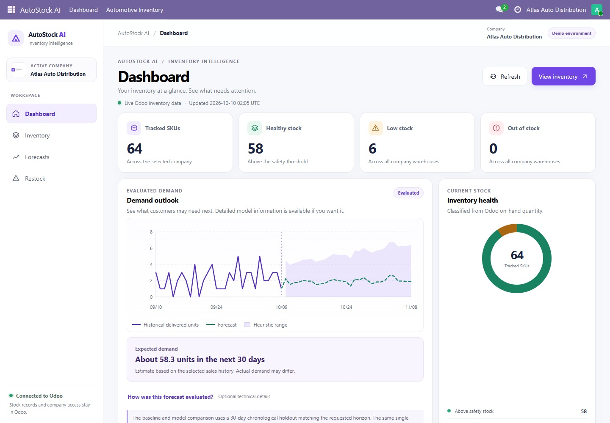
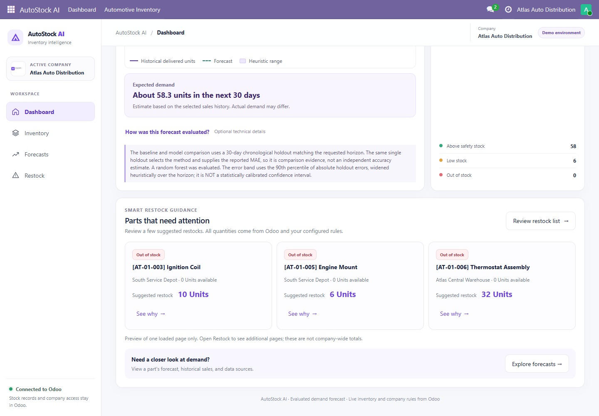
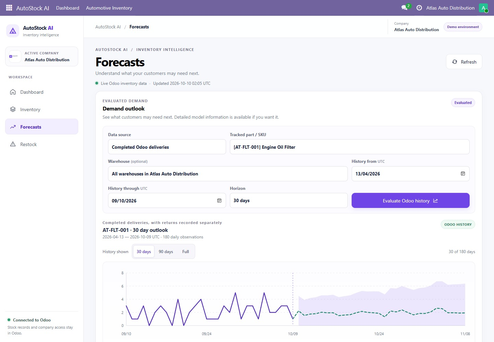
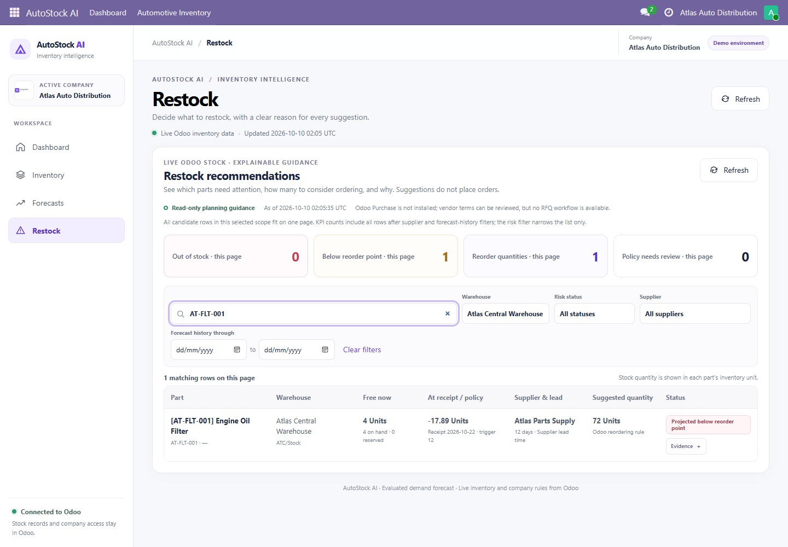
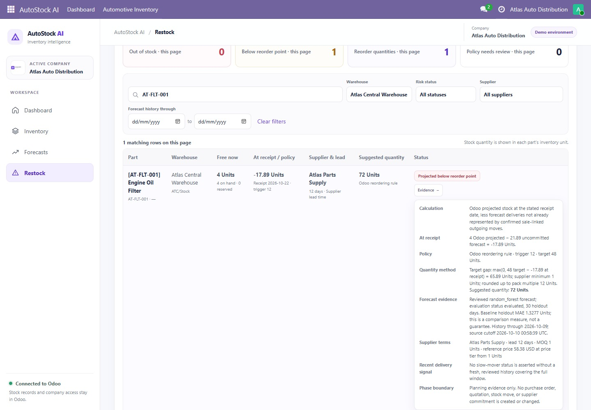
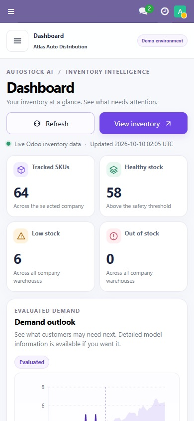
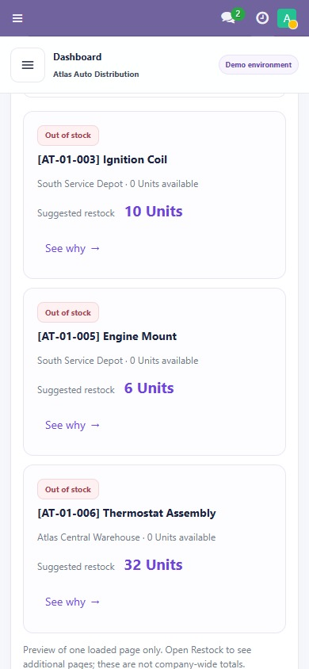
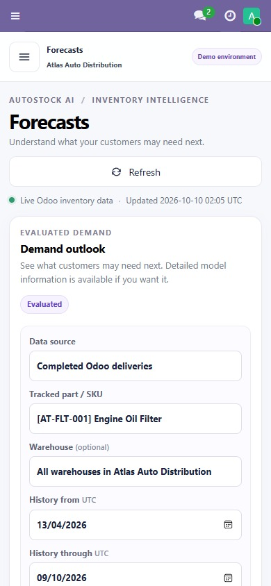
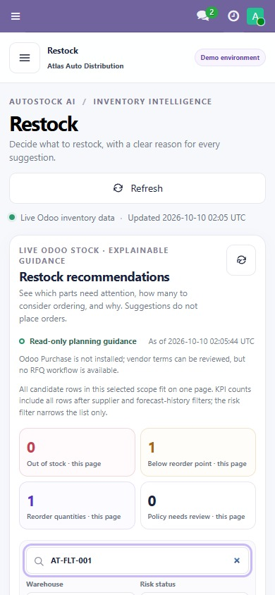
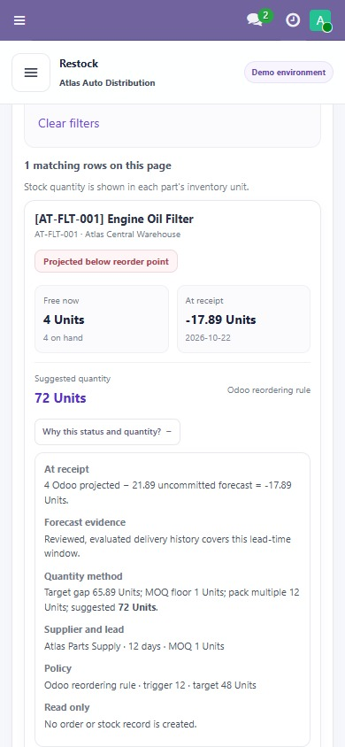

# PR #19 browser QA: Dashboard, Forecasts, and Restock

Status: completed on `codex/dashboard-information-architecture`. This is a local browser review of the implementation in PR #19; the PR remains unmerged. The app ran against the dedicated `autostock_showroom_demo` Odoo 19 database and its isolated PostgreSQL 16 service.

## Results

- The Windows PowerShell 5.1 launcher completed successfully with the documented command. Its UTF-8 BOM was missing, which made PowerShell 5.1 misread the en dash in a message as a quote. Adding the BOM fixed parsing; the launcher updated AutoStock AI in the existing showroom, and the seed reported that no records were changed.
- The Playwright browser flow passed at 1440×1000 desktop, 1024×900 tablet, 390×844 mobile, and 320×780 compact mobile. It authenticated only to `autostock_showroom_demo`, and reported no browser errors or horizontal overflow.
- Navigation between Dashboard, Forecasts, and Restock changes the active heading and moves keyboard focus to it. The mobile drawer opens and closes during navigation. The mobile app bar now gives the active screen a readable line above the company name and demo marker; the breadcrumb no longer clips at 390px or 320px.
- Dashboard showed 64 tracked products and a live restock preview bounded to three rows. The preview's “See why” action opened Restock. The full inventory and risk tables were absent from Dashboard.
- Forecasts opened the evaluated Odoo-history run for `AT-FLT-001` (Engine Oil Filter), showed 180 daily observations, changed between 7-, 30-, and 60-day horizons, and displayed Full history. The business-language demand summary and optional evaluation details were checked; source evidence opened and closed correctly.
- Restock filtered to Atlas Central Warehouse and `AT-FLT-001`, returned the single matching row, and displayed the live calculated suggestion of 72 inventory units. Its expanded evidence showed the stock position, eligible reviewed forecast, Odoo reorder policy, supplier lead time, quantity method, and read-only boundary. No order was created.

The browser runner also checks that Dashboard does not expose the full Restock table, Forecasts does not include Dashboard KPIs, and Restock does not include the full forecasting panel. The test-only Playwright package was installed under the ignored `.showroom` directory.

## Visual comparison

The live UI follows the reference's light surfaces, restrained violet accent, KPI cards, readable charts, and clear status colors while keeping the Odoo navigation and company context visible. PR #19 intentionally separates the working parts of the application into Dashboard, Forecasts, and Restock; the reference combines these areas on one screen and includes unsupported assistant, report, purchasing, and accuracy elements. The implementation keeps the actual Odoo-driven forecast and inventory evidence and does not reproduce those illustrative claims.

The mobile screenshots showed the app-bar breadcrumb compressed to one letter beside the company and demo marker. The app bar now uses two rows on narrow screens, preserving the complete active page name and company context. No other rendering or interaction issue was found in the exercised flows.

## Screenshots

All captures below came from the local Playwright-controlled browser and contain only the fictional showroom data.

### Desktop

### Mobile

The screenshot directory also contains the 1024px tablet captures, 320px compact-mobile captures, full-history chart views, forecast source/evaluation evidence, native Odoo product search, and the mobile navigation drawer.

## Limits

The company, products, sales, stock, supplier terms, and forecast history are generated fictional data. The `72`-unit suggestion is the result of AutoStock's existing Odoo-backed rules for this fixture only. It is not a business benchmark or a purchase order. This QA does not establish production readiness or validate any unfinished feature.
