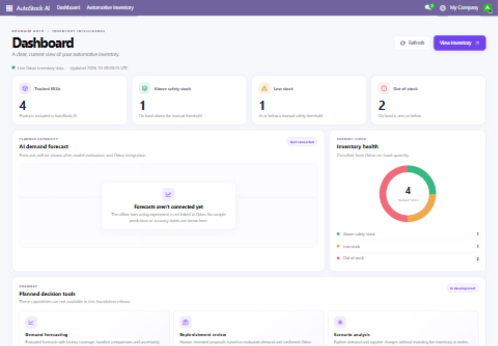
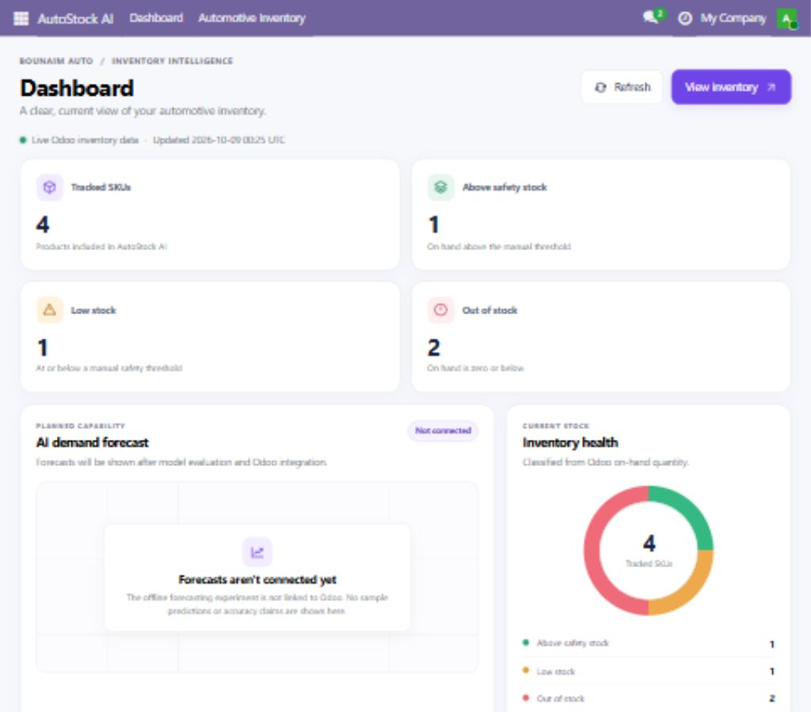
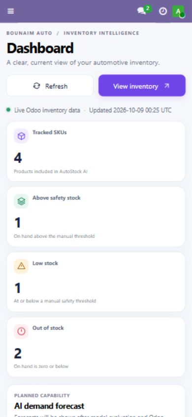
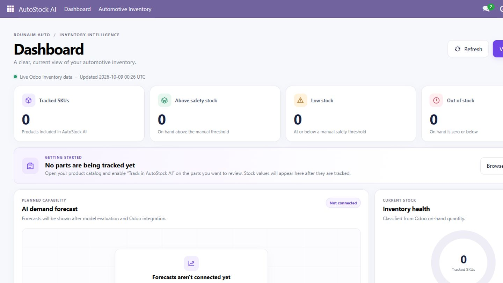

# AutoStock AI foundation validation

**Run date:** 2026-10-09
**Branch:** `codex/foundation-validation-20261009`
**Scope:** validate the existing Odoo addon and forecasting experiment, repair setup gaps, and refine the dashboard foundation. No advanced forecasting or replenishment feature was represented as complete.

## Environment

- Docker Compose: `odoo:19.0` (`19.0-20260926`) and `postgres:16` (PostgreSQL 16.15); database container healthy and Odoo listening on `127.0.0.1:8069`.
- `autostock_demo`: addon installed and exercised in the browser.
- `autostock_test`: clean database used for the Odoo addon test run and empty-state browser check.
- Python 3.12 virtual environment, matching the new GitHub Actions workflow.

## Automated checks

| Check | Result | Evidence |
| --- | --- | --- |
| Python tests | **14 passed** | `.\.venv\Scripts\python.exe -m pytest -q` |
| Python compile check | **Passed** | `.\.venv\Scripts\python.exe -m compileall -q addons ml scripts tests` |
| Odoo addon tests | **10 passed, 0 failed, 0 errors** | Fresh `autostock_test` database with `--init=autostock_ai --test-enable --test-tags=/autostock_ai --stop-after-init --without-demo=true` |
| Docker Compose config | **Passed** | `docker compose config --quiet` |
| Forecast evaluation | **Completed for 6 labeled synthetic SKUs** | The evaluator selected either its baseline or ML method per fixture. This is a pipeline smoke test; no accuracy result is claimed. |

The test suite checks invalid product settings, empty dashboard values, stock-status calculations from Odoo on-hand quantities, single-product values, inventory-group access, the capped dashboard preview, the large-catalog incomplete flag, and prevention of tracking non-storable products.

## Odoo and database checks

- Installed and loaded the custom `autostock_ai` addon in Odoo 19. The dashboard is an Odoo client action and its product links open the matching `product.template` form.
- Verified the dashboard is backed by Odoo's stockable product quantities and manual safety-stock values. No `sudo` bypass was added.
- Opened the product catalog from the dashboard. It includes stockable products that are not yet tracked, so a user can opt a part into AutoStock.
- In the browser, enabled AutoStock tracking for the QA-only cooling-hose record, saved it, reloaded the form, and confirmed the setting persisted.
- A user without the inventory group receives `AccessError` from the dashboard model in the Odoo test suite.
- On a transaction-local large-catalog run, 5,004 tracked records produced a 5,000-record sample with `summary_incomplete=true` and a 12-row table preview. The temporary records were rolled back after the check.

The demo database contains four **synthetic QA fixtures**. They are labeled `[QA SAMPLE]` and are not business data:

| Fixture SKU | On hand | Safety stock | Dashboard classification |
| --- | ---: | ---: | --- |
| `QA-HEALTHY-003` | 12 | 3 | Above safety stock |
| `QA-LOW-001` | 2 | 3 | Low stock |
| `QA-OUT-002` | 0 | 5 | Out of stock |
| `QA-UNTRACKED-004` | 0 | 0 | Out of stock after enabling tracking in the product form |

The resulting live dashboard shows 4 tracked SKUs: 1 above safety stock, 1 low, and 2 out of stock. The clean test database shows zeroes and the empty-state prompt.

## Browser and visual review

Compared the live dashboard to [`design/dashboard-concept.png`](../../design/dashboard-concept.png). The implementation keeps the reference's violet accent, light canvas, rounded white cards, status colors, donut summary, and dashboard hierarchy while retaining Odoo navigation and using live Odoo inventory values. Reference-only forecasts, accuracy, reorder recommendations, and vehicle insights remain clearly marked as disconnected or planned.

The responsive pass used 1440×1000, 1024×900, and 390×844 viewports. At 390px the document stays 390px wide; the 730px inventory table is inside its own 330px `overflow:auto` region, rather than causing page-level horizontal overflow. The browser console had no errors after the asset fix.

### Demo dashboard

### Empty state

## Setup and defects corrected

- Added `.gitignore`, a credential-free `.env.example`, and a read-only GitHub Actions workflow for Python tests, compilation, and the labeled synthetic forecast evaluation. The local `.env` remains ignored.
- Fixed Windows text decoding in a structural test by specifying UTF-8.
- Limited dashboard counts to active, storable, tracked products; fixed the inventory action so users can find untracked storable products.
- Fixed product-row navigation to open the product template form, where the AutoStock fields live.
- Added validation that prevents non-storable products from being tracked.
- Removed eager test-framework imports from the addon business package; Odoo discovers addon tests when test mode is enabled.
- Corrected the Odoo 19 user group API in tests and fixed SCSS expressions that Odoo's asset compiler rejected.
- Reworked the dashboard spacing, icons, status hierarchy, empty and disconnected states, focus treatment, responsive layout, and horizontally scrollable inventory table.

## Remaining work and recommended next steps

- Connect the offline forecast evaluator to Odoo only after agreeing on a real-data evaluation protocol, history-coverage checks, baseline comparisons, and uncertainty reporting. The dashboard correctly shows no forecast or accuracy value today.
- Replenishment review, scenario analysis, vehicle fitment, and production recommendations remain unimplemented.
- Add an Odoo 19/PostgreSQL integration job to CI; the current workflow covers the Python suite and offline evaluation, while the addon integration suite was run locally in Docker for this validation.
- Replace the clearly labeled QA fixtures with approved product and stock data before using the demo database for business decisions.
