# P3A.5 showroom setup and visual QA

Status: tested on the `codex/phase3a5-showroom-demo` branch for local product review. This is a fictional demonstration environment, not a production deployment.

## Start and sign in on Windows

1. Start Docker Desktop and wait for its WSL2 engine to finish starting.
2. Open PowerShell in the AutoStock AI repository folder and run:

   ```powershell
   powershell -NoProfile -ExecutionPolicy Bypass -File .\scripts\start_showroom_demo.ps1
   ```

3. Open the URL printed by the command (it also opens the sign-in page). Sign in as `admin`. Read the generated password from `.showroom\credentials.txt`; it is local-only and ignored by Git.
4. Confirm the Atlas Auto Distribution company and its **Demo environment** indicator, then follow the [short showroom walkthrough](../SHOWROOM_GUIDE.md).

The setup uses a separate PostgreSQL 16 service, Odoo 19 container, `autostock_showroom_demo` database, filestore volume, localhost-only port, and Compose project. It does not connect to the general development database or alter another Compose stack. Re-running setup reuses the recorded credentials and data. `-Stop` retains the database; `-Reset` requires typing the exact showroom database name and removes only that database.

## Fictional business data and real application paths

The local seed created Atlas Auto Distribution, its logo, 64 natural-name automotive parts, two warehouses, four suppliers, three fictional customers, product supplier terms and reorder policies, and 174 confirmed sale orders with completed Odoo deliveries over 180 generated days (13 April–9 October 2026). Each sale and delivery was created and validated through Odoo. Closing inventory was set with Odoo's stock quant API. The four featured parts have 12 completed and manager-reviewed AutoStock forecast runs: 7, 30, and 60 days per part.

The histories, businesses, and all monetary/quantity values are fictional. The forecast worker and stock-risk service calculate outputs from those Odoo records and existing application rules; screenshots do not supply business results. The local fixture uses a narrow, parameterized SQL update only for the Odoo product creation timestamps that anchor its generated history. Odoo blocks ORM writes to its audit columns after registry startup. Product, sale, move, stock, supplier, rule, and forecast business records are written through Odoo models and workflows. The seeder refuses every database except `autostock_showroom_demo` and is a no-op after the seed version is recorded.

The captured company-level dashboard showed 64 tracked parts, 58 above safety stock, six low, and zero out of stock across both warehouses. The central-warehouse risk screen separately showed a calculated recommendation of 72 inventory units for Engine Oil Filter (`AT-FLT-001`) using its reviewed 30-day Odoo-delivery forecast and native Odoo reorder rule. These are values from this fictional database only, not business benchmarks or accuracy claims.

## Checks run

- `python -m pytest -q` — 40 passed.
- `python -m compileall -q addons ml scripts tests` — passed.
- `node --test scripts/test_qa_phase3a_browser_guard.mjs` — 2 passed. A wrong database is rejected before browser launch, login/network requests, or screenshot directory creation.
- Odoo 19 integration suite against an isolated PostgreSQL 16 database — 39 addon tests, 0 failures, 0 errors. The test Compose project and its volumes were removed afterward; the showroom database was not used for integration tests.
- `python scripts/generate_synthetic_sales.py` and `python -m ml.evaluate ml/output/synthetic_daily_sales.csv --days 30 --output .showroom/forecast-eval.json` — completed for all six synthetic lab SKUs. This is a separate offline synthetic evaluation; the result does not establish real-world performance.
- PowerShell parser, Node syntax checks, and `docker compose --file compose.showroom.yml config --quiet` — passed.
- The read-only browser runner authenticated against Odoo, verified the session's database name, opened and searched the native Odoo product list, loaded dashboard and risk data, changed forecast horizons, expanded evidence, checked responsive navigation and horizontal overflow, and captured screenshots at 1440×1000 desktop, 1024×900 tablet, and 390×844 mobile. It verified the matching part is selected for the visible saved forecast, the 180-day chart history, all three supported horizons, and a forecast-backed reorder result. There were no browser console or page errors.
- The Issue #15 Phase 3A browser QA runner now accepts only `autostock_phase3a_qa`, verifies the authenticated Odoo database before writes, deletes only IDs created by its run, and exits unsuccessfully if cleanup fails. The guard regression test also proves a wrong database causes no login request or screenshot write.

Screenshots contain only fictional showroom data. They were saved directly from a local Playwright-controlled Edge/Chromium browser; no passwords appear in the images.

## Visual comparison with the approved concept

The running screen carries the concept's light neutral canvas, restrained purple navigation and primary actions, left-side application navigation, KPI cards, inventory health chart, and demand history/forecast chart. The 180-day plot uses its available responsive width. The real Odoo top bar and company switcher remain visible, and the discreet demo marker explains the generated records.

The concept includes an AI assistant, a report generator, purchasing workflows, an extra forecast-accuracy KPI, and illustrative data. Those features and claims are not present in this showroom because they are unfinished or unsupported. The current application focuses on the working Odoo dashboard, delivery-history forecasting, and read-only risk/reorder guidance. On tablet and mobile, users scroll the dashboard panels and open the compact navigation drawer; screenshots show those actual responsive states. This keeps the current demonstration consistent with the concept's visual direction without presenting mock features as complete.

## Screenshots

### Desktop (1440×1000)

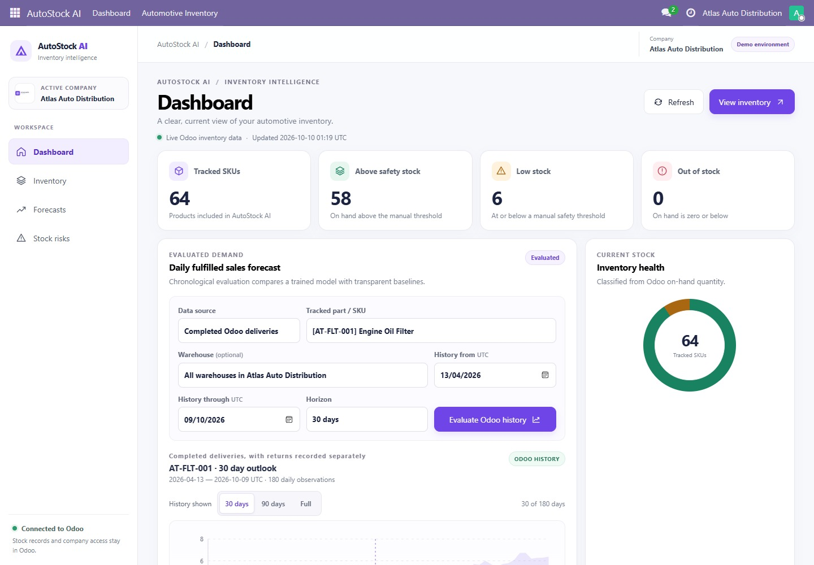

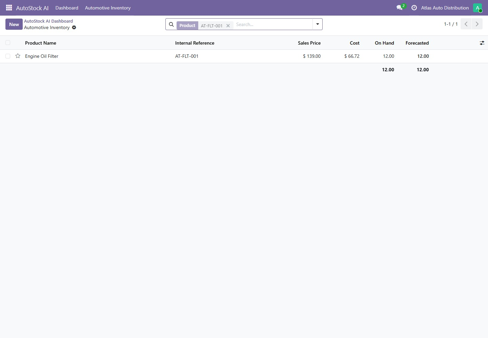

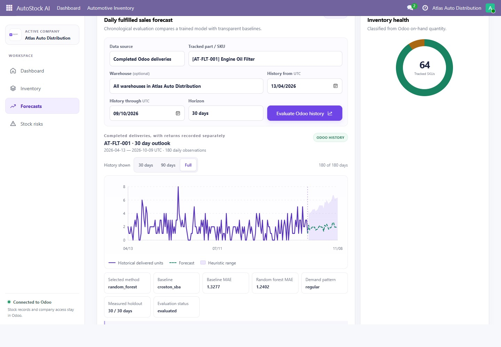

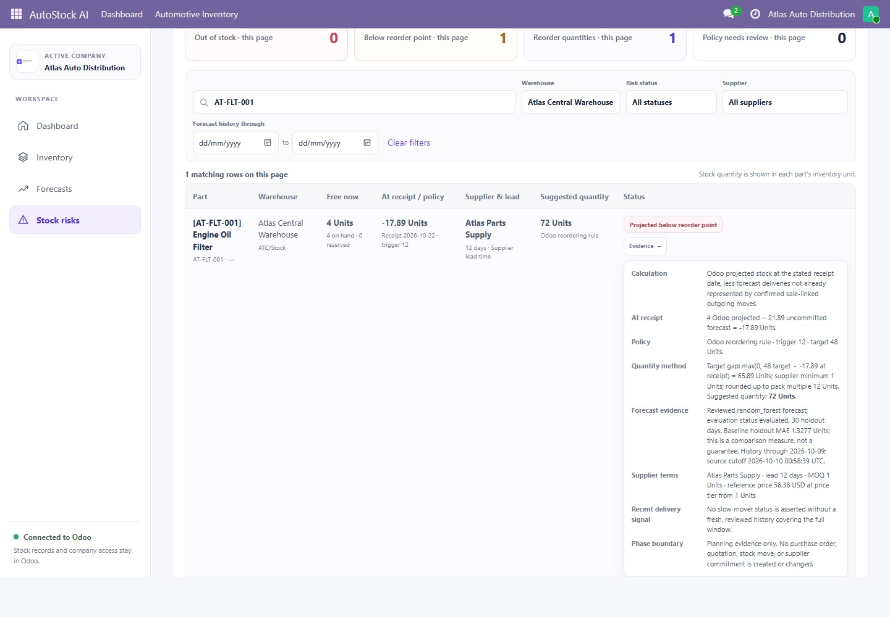

### Tablet (1024×900)

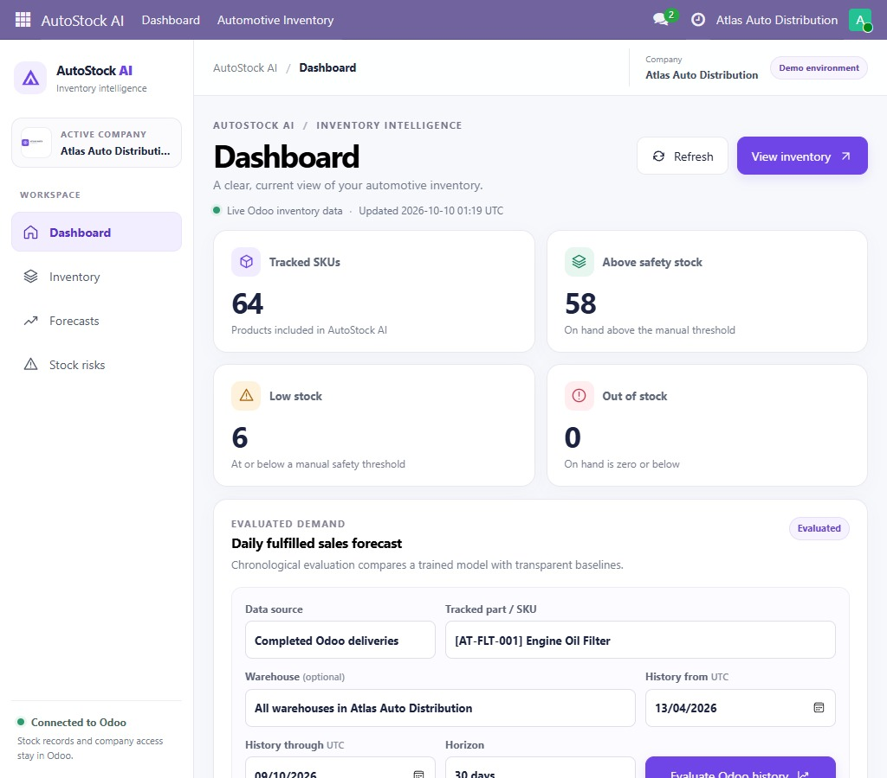

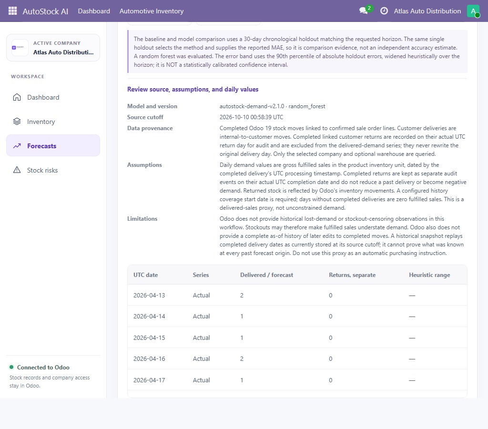

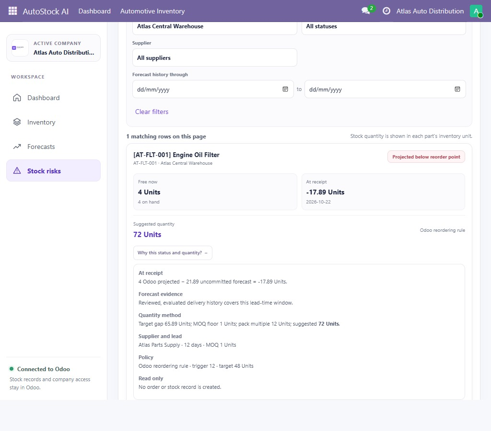

### Mobile (390×844)

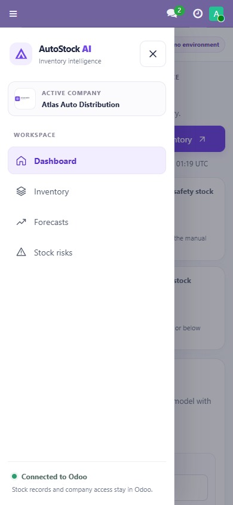

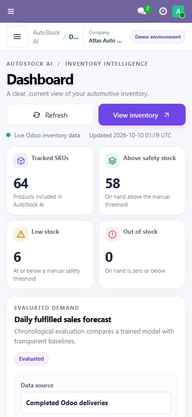

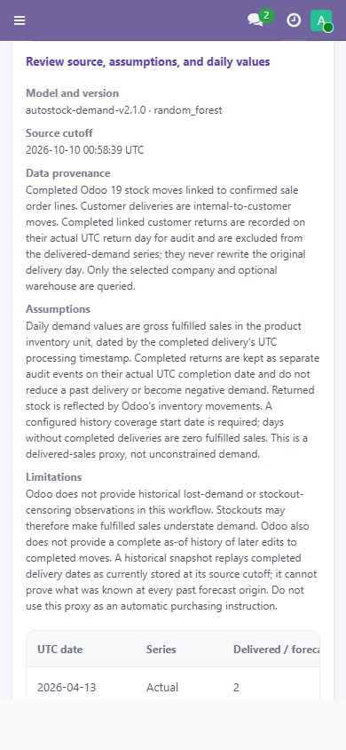

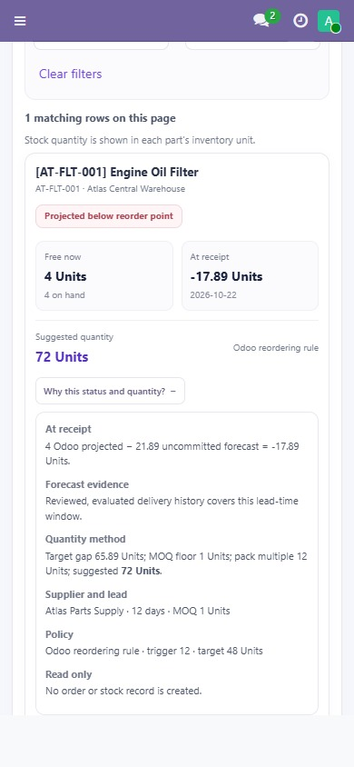

## Remaining limits and next steps

- All company, customer, vendor, product, sales, stock, and price data is generated for demonstration. Do not import this database into a live business or treat forecast metrics as evidence of real-world accuracy.
- The demonstration is local-only and is not hardened for internet exposure. No advanced Phase 3B/3C features, automatic purchasing, report generator, or assistant were added.
- Before a commercial release, complete the requirements tracked by Issues #7 and #8, evaluate against a consented real-business dataset, and verify backups, restoration, operations, accessibility, and security independently.
- Next review steps: open the startup command on the product owner's Windows laptop, follow the walkthrough, and give feedback on navigation, product naming, warehouse states, and forecast explanations before Phase 3B.
